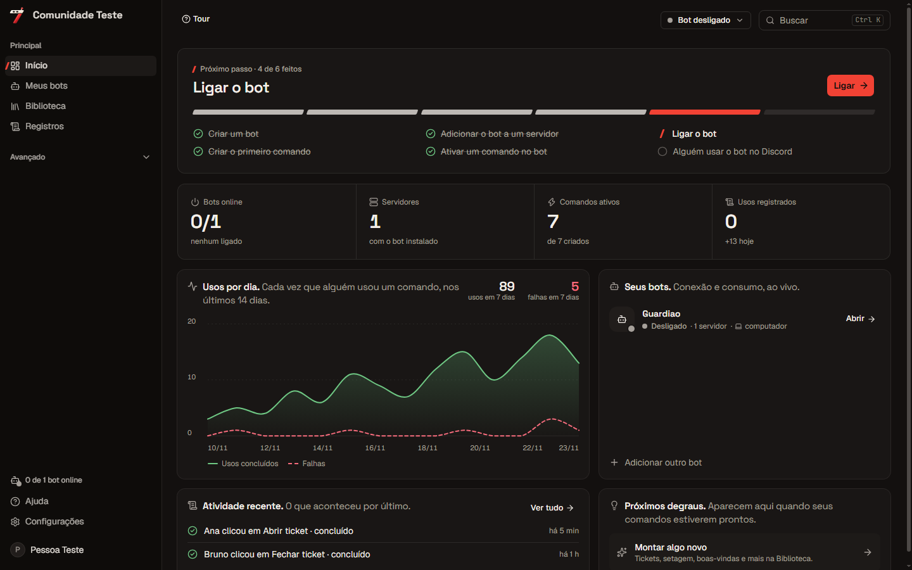
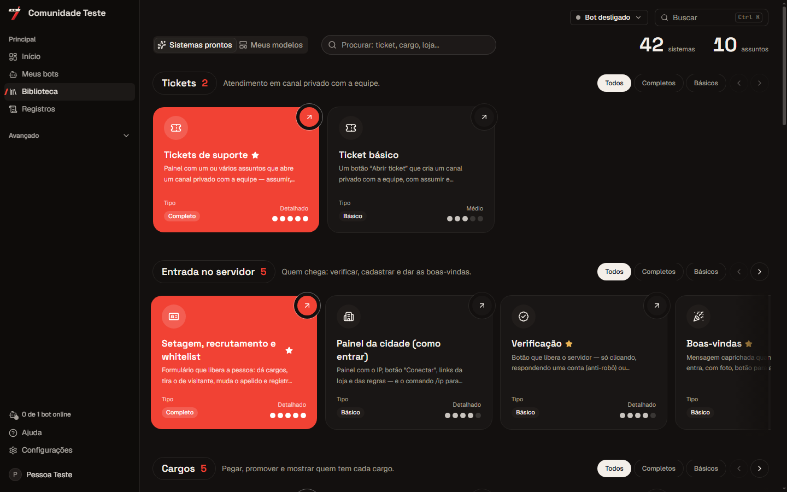
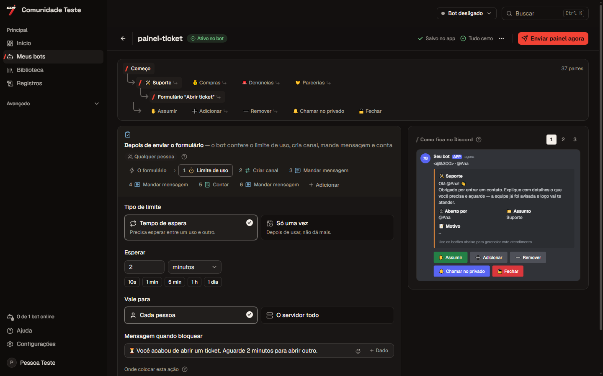
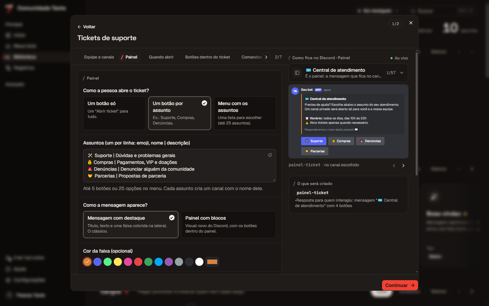
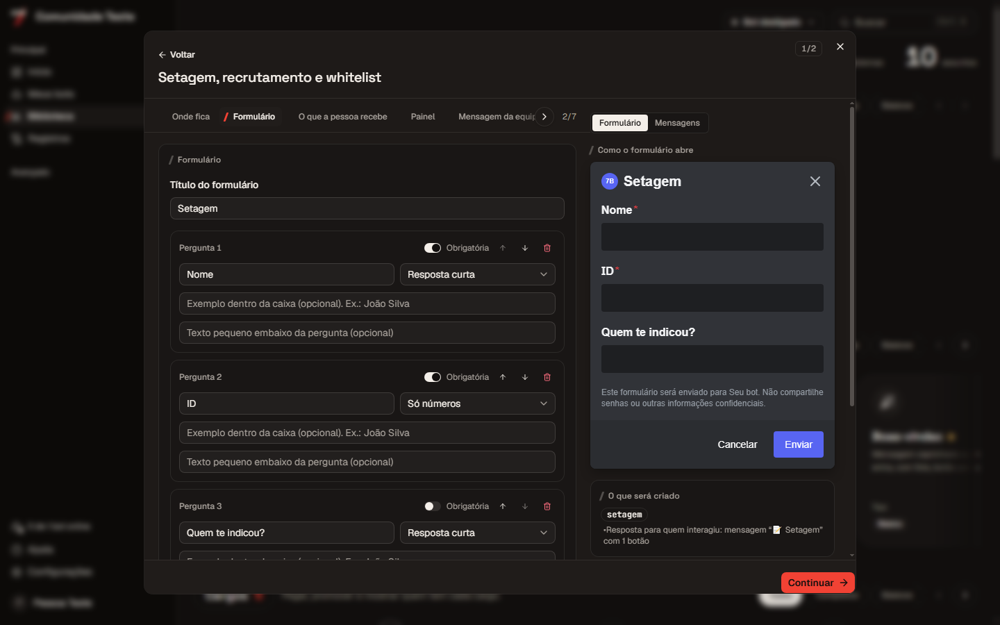
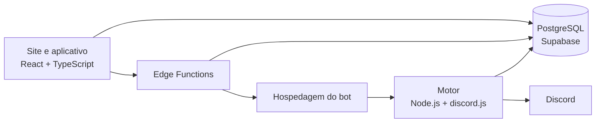

  

<h1 align="center">7Bots</h1>

  Plataforma para criar bots de Discord sem escrever código. 
  <a href="https://7bots.pages.dev"><strong>Abrir a demo</strong></a>

> **O código é privado.** O 7Bots é um produto em uso, então este repositório é só a apresentação do projeto: o que ele faz, como foi pensado e como ficou. Posso mostrar o código em uma entrevista.

## O problema

Quem tem um servidor de Discord quer tickets, cadastro de membros, boas-vindas ou loja, mas quase sempre precisa pagar alguém para programar ou usar um bot genérico, com o nome e a cara de outra empresa.

No 7Bots a pessoa monta tudo por telas e formulários. Cada bot é uma aplicação própria no Discord, com nome e foto escolhidos por ela.

## O que dá para fazer

- **Biblioteca com 42 sistemas prontos:** tickets, whitelist, candidaturas, moderação, economia, sorteios, bate-ponto e outros, com textos e formulários personalizáveis.
- **Construtor visual:** botões, menus, formulários, condições e mais de um caminho no mesmo comando, com a árvore de partes sempre à vista.
- **Prévia ao vivo:** a mensagem, o formulário e os canais aparecem como vão ficar no Discord.
- **Hospedagem:** o bot roda no computador da pessoa ou na nuvem, ligado e desligado pelo site.
- **Conversas de ticket salvas** em página com senha.
- **Versões, desfazer e simulação** para testar sem mexer no servidor de verdade.

| Biblioteca | Construtor |
|---|---|
|  |  |
| **Sistema pronto, com prévia** | **Editor de formulário** |
|  |  |

As imagens usam dados fictícios.

## Como funciona

- **Um modelo só para tudo:** o comando é um documento validado com Zod. Site, simulador e motor usam o mesmo pacote, então a prévia e o bot interpretam a mesma definição.
- **Dados isolados por comunidade:** regras de acesso por linha no próprio banco, e não só na tela.
- **Segredos fora do navegador:** os tokens dos bots ficam no cofre do banco e só são usados no servidor.
- **Motor atualizável:** o bot hospedado baixa a versão nova do motor ao reiniciar.

## Tecnologias

| Parte | Usa |
|---|---|
| Site e aplicativo | React 19, TypeScript, Vite, Tailwind CSS, TanStack Query, Zustand, Tauri |
| Motor do bot | Node.js, discord.js |
| Banco e servidor | PostgreSQL, Supabase (Auth, RLS, Edge Functions) |
| Validação e testes | Zod, Vitest (mais de 400 testes automatizados) |
| Publicação | Cloudflare Pages |

## Sobre o desenvolvimento

Projeto de **Michel Silva** ([@mlnolove](https://github.com/mlnolove)), estudante de Análise e Desenvolvimento de Sistemas, desenvolvido com auxílio de IA.

## Direitos

© 2026 Michel Silva. Todos os direitos reservados. Textos e imagens deste repositório não podem ser reutilizados sem autorização.
